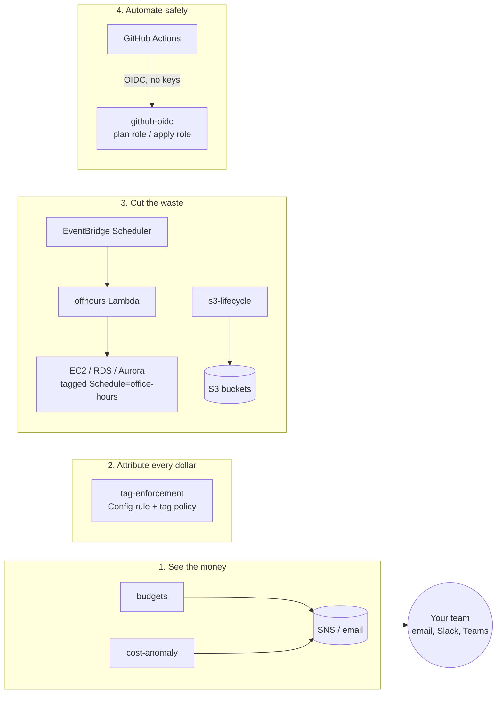

# aws-finops-guardrails

[](https://github.com/sajedul5/aws-finops-guardrails/actions/workflows/ci.yml)
[](LICENSE)


**Stop AWS bill surprises.** Six small Terraform modules that alert you before you overspend, catch cost spikes within a day, make every dollar traceable to a team, and switch off what nobody is using.

Safe by default: nothing is deleted, stopped or blocked unless you opt in.

**[Estimate your savings →](https://sajedul5.github.io/aws-finops-guardrails/)** (interactive calculator)

---

## The problem

| What usually happens | What this repo adds |
|---|---|
| The bill arrives and it's 40% higher than last month | **Budgets** email you at 50%, 80% and 100%, and when AWS *forecasts* you'll go over |
| A forgotten GPU instance runs for three weeks | **Cost anomaly detection** alerts you within about a day |
| Nobody knows which team owns half the spend | **Tag enforcement** flags untagged resources and standardises tags across the organization |
| Dev and test servers run all night and all weekend | **Off-hours scheduler** stops them at 20:00 and starts them at 08:00 on weekdays |
| Years of logs sit in S3 Standard | **S3 lifecycle** moves old data to cheaper storage classes |
| CI deploys with long-lived AWS keys | **GitHub OIDC** gives short-lived credentials, with an approval before every deploy |

## How it fits together



## Modules

| Module | What it does | Running cost | Docs |
|---|---|---|---|
| `budgets` | Monthly and per-service budgets with actual and forecast alerts | Free | [README](modules/budgets/README.md) |
| `cost-anomaly` | ML-based spike detection across all services | Free | [README](modules/cost-anomaly/README.md) |
| `tag-enforcement` | AWS Config `required-tags` rule, plus an opt-in Organizations tag policy | ~$1–30/month (Config) | [README](modules/tag-enforcement/README.md) |
| `offhours-scheduler` | Stops and starts tagged EC2, RDS and Aurora on a schedule, with a dry-run mode | ~$0 (free tier) | [README](modules/offhours-scheduler/README.md) |
| `s3-lifecycle` | Standard-IA → Glacier IR tiering, or Intelligent-Tiering; cleans up old versions and failed uploads | Free | [README](modules/s3-lifecycle/README.md) |
| `github-oidc` | Keyless GitHub Actions access: read-only plan role, approval-gated apply role | Free | [README](modules/github-oidc/README.md) |

## Quick start

### Try it on your laptop: no AWS account needed

```bash
git clone https://github.com/sajedul5/aws-finops-guardrails.git
cd aws-finops-guardrails
make setup   # one time: installs the Python test libraries in .venv
make demo    # the scheduler stops/starts servers in a FAKE AWS account
make test    # every test, offline
```

### Deploy to your AWS account

The [`single-account`](examples/single-account) example adds budgets, anomaly alerts, the scheduler (in dry-run) and optional S3 tiering. It changes nothing that is already running.

```bash
cd examples/single-account
cp terraform.tfvars.example terraform.tfvars   # your budget, emails and timezone
terraform init
terraform plan                                  # preview; changes nothing
terraform apply
```

Or use one module in your own code:

```hcl
module "budgets" {
  source = "github.com/sajedul5/aws-finops-guardrails//modules/budgets?ref=v0.1.0"

  monthly_limit = 5000
  alert_emails  = ["finops@example.com"]
}
```

👉 **[Getting started guide](docs/GETTING_STARTED.md)**: step by step, from the laptop demo to GitHub Actions deploys, plus fixes for common errors. For AWS Organizations and tag policies, see the [`complete`](examples/complete) example.

## Estimated savings

There is no client data behind these numbers. They are **typical estimates** for an example team, with each assumption stated.

*Example: a team spending $10,000/month on AWS, of which $3,000 is dev/test EC2 and RDS and $1,000 is S3 storage that is mostly older than 30 days.*

| Guardrail | Assumption | Estimated saving |
|---|---|---|
| Off-hours scheduler | Runs 60 of 168 hours a week (08:00–20:00, Mon–Fri), so ~64% fewer compute hours. Storage is still billed. | up to ~$1,900/month |
| S3 lifecycle | Standard-IA is ~45% cheaper and Glacier IR ~80% cheaper than Standard (us-east-1 list prices) | ~$300–600/month |
| Cost anomaly detection | One runaway resource at $200/day, caught on day 1 instead of day 30 | ~$5,800 per incident avoided |
| Budgets + tag enforcement | Teams that see their own costs often cut 10–20% themselves (FinOps practice; varies widely) | varies |

**Cost to run all of it: typically under $30/month**, mostly the AWS Config rule. Your results depend on your workload; measure before and after in Cost Explorer.

## Built to be trusted

- **Tested on every pull request.** Five required checks: `terraform` (fmt, validate, 34 `terraform test` cases with a mock provider), `min-provider` (each module at AWS provider 5.80 exactly), `tflint`, `checkov` (Terraform and workflows), and `pytest` (12 tests for the scheduler Lambda, using moto).
- **Least privilege.** The scheduler can only stop resources that carry the opt-in tag, and IAM enforces that, not just the code. The CI apply role has no permissions until you grant them.
- **Every security exception is explained.** Each skipped checkov finding has a written reason, such as "a VPC would need a NAT gateway (~$32/month)" ([example](modules/offhours-scheduler/main.tf)).
- **Supply-chain safe CI.** GitHub Actions are pinned to exact commit SHAs, so a moved tag can't change what runs.
- **Protected `main`.** Changes land only through reviewed pull requests with all checks green.

## Development

```bash
make help  # list every command
make ci    # everything CI runs: validate, test, lint, security, min-provider
```

See [CONTRIBUTING.md](CONTRIBUTING.md) for the workflow and module rules, and [CHANGELOG.md](CHANGELOG.md) for what changed.

## Need help with your AWS bill?

I help teams roll these guardrails out in about **four weeks**: see the spend (weeks 1–2), attribute it to teams (week 3), and cut the waste (week 4). The rollout fits your accounts, tags and working hours, and your team gets a handover.

- **Questions or ideas:** [open an issue](https://github.com/sajedul5/aws-finops-guardrails/issues)
- **Work with me:** contact [@sajedul5](https://github.com/sajedul5) on GitHub, or see the [overview and savings calculator](https://sajedul5.github.io/aws-finops-guardrails/)

If this repo saves you money, a ⭐ helps others find it.

## License

[MIT](LICENSE). Free to use, change and share.
